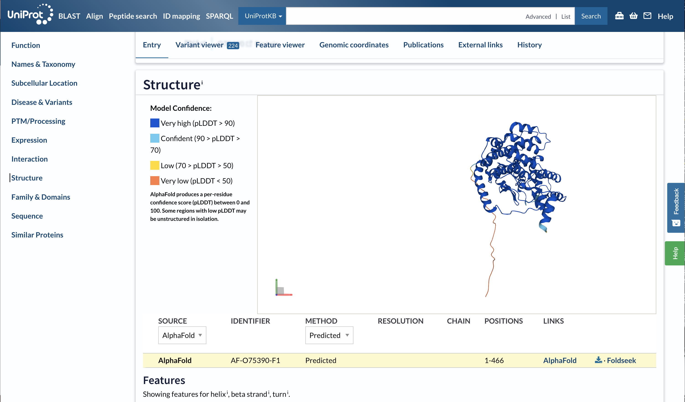
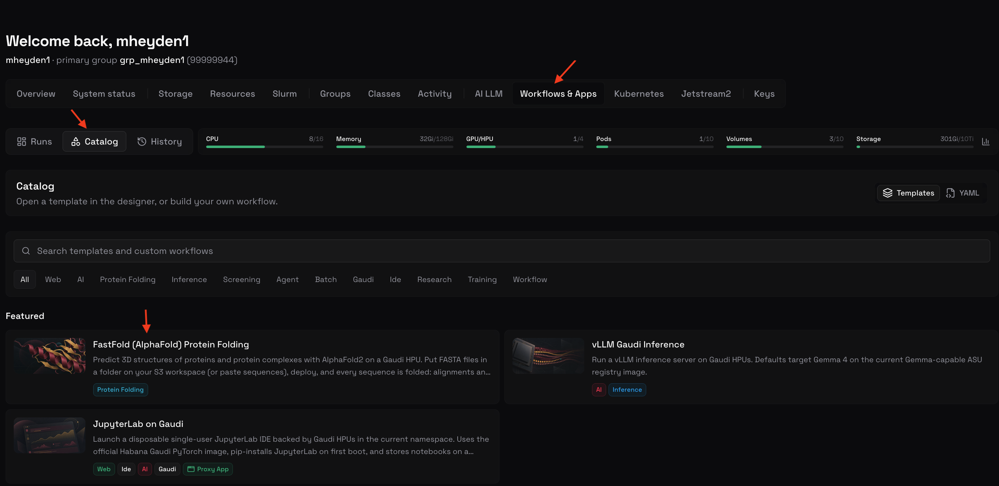
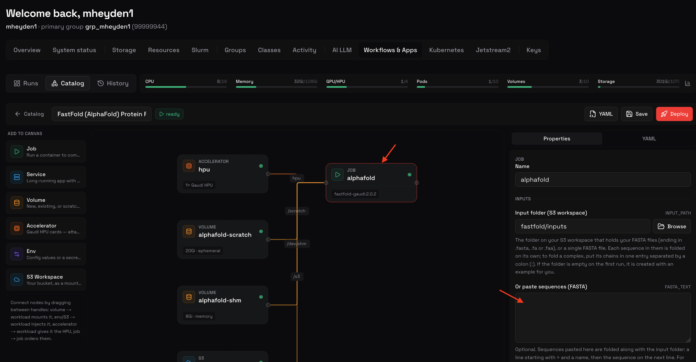

# Homework 4 Part 1 #

Special thanks to Josh Vermaas (Michigan State University), who prepared an earlier version of this tutorial!

AlphaFold and related tools combine information from protein sequence and structure databases to predict three-dimensional protein structures.

The main goals of this exercise are:

- Become familiar with several web servers for protein structure prediction.
- Learn to use local high-performance computing resources to predict more complex protein structures.

## Do I need to run AlphaFold at all?

Predicted structures are already available for many proteins, so you may not need to run AlphaFold yourself. The [AlphaFold Protein Structure Database](https://alphafold.ebi.ac.uk/) provides predictions generated using AlphaFold, many of which can also be accessed through [UniProt](https://www.uniprot.org/).

For example, numerous experimentally determined structures are available for citrate synthase, the enzyme that catalyzes the first reaction of the citric acid cycle. The **Structure** section of the [UniProt entry for human citrate synthase](https://www.uniprot.org/uniprotkb/O75390/entry) also includes an AlphaFold2 prediction that can be viewed online or downloaded.



## Protein structure prediction web servers

For a quick protein structure prediction, the simplest approach is often to use AlphaFold or a related tool through a web server. You provide one or more protein sequences, and the server uses remote computing resources to generate the predicted structure.

A popular option is [ColabFold](https://github.com/sokrypton/ColabFold), which provides an accessible, interactive interface through a Jupyter notebook. ColabFold accelerates the multiple sequence alignment (MSA) and homology-search steps used by AlphaFold. The method is described in the [paper accompanying the web server](https://doi.org/10.1038%2Fs41592-022-01488-1).

Several other web servers are also available. Protein structure prediction is a rapidly evolving field, and different research groups have developed methods that aim to improve prediction accuracy or reduce computational cost. For example, Meta developed ESMFold, a neural-network model for [predicting protein structures](https://esmatlas.com/). The method was published in [_Science_ in 2023](https://doi.org/10.1126/science.ade2574).

Other established methods also remain available. Before machine-learning approaches became widespread, I-TASSER, for example, was among the leading tools for protein structure prediction. The [I-TASSER web server](https://zhanggroup.org/I-TASSER/) provides an opportunity to explore an approach developed before AlphaFold.

In the following, we will compare multiple protein structure prediction tools using several web servers. We will predict the structure of the following short amino acid sequence. The sequence is expected to form both alpha-helical and beta-sheet secondary structures.

```
PIAQIHILEGRSDEQKETLIREVSEAISRSLDAPLTSVRVIITEMAKGHFGIGGELASK
```

Copy the amino acid sequence and submit it to each of the following web servers:

- [ESMFold](https://esmatlas.com/resources?action=fold), developed by Meta
- [ColabFold](https://colab.research.google.com/github/sokrypton/ColabFold/blob/main/AlphaFold2.ipynb), developed at Seoul National University
- [RoseTTAFold](https://neurosnap.ai/service/RoseTTAFold%20All-Atom), developed by the Baker laboratory at the University of Washington (requires a NeuroSnap account; limited free credits are available)
- [D-I-TASSER](https://zhanggroup.org/D-I-TASSER/), developed by the Zhang group at the National University of Singapore (formerly at University of Michigan)

As you work through the web servers, consider the following questions:

1. How long does each server take to return a result? If a prediction takes longer than 24 hours, you may omit it from the comparison.
2. When entering the sequence, can you determine whether the method supports the prediction of protein complexes?
3. How similar are the structures predicted by the different methods?
4. How can you download each predicted structure to your computer for further analysis?

Some predictions may take a while to complete. Keep the corresponding browser tabs open while you continue working through the list.

***Download and save each predicted structure in PDB format. You will analyze these files later.***

## AlphaFold3 @ ASU ##

There are multiple reasons not to use webservers. For example, you may be working in protein design and need to protect intellectual property (the amino acid sequence of your protein). Or you need to predict the structure of a larger set of sequences, which goes beyond what free webservers allow you to do.

The AlphaFold models and parameters have been released to the public. 

- [AlphaFold2 on GitHub](https://github.com/google-deepmind/alphafold)
- [AlphaFold3 on GitHub](https://github.com/google-deepmind/alphafold3)

In principle, you could install AlphaFold2 or AlhpaFold3 on your own computer. However, as many ML/AI applications, these models work best on specialized hardware (GPUs or, as in our cse, HPUs), require the download of large datasets, additional tools for multiple sequence alignments (MSA), etc. 

However, ASU's Research Computing team has done this for us and AlphaFold3 is ready to run on the new Intel Gaudi2 system with a user friendly interface. Go to your [voyager page](voyager.rc.asu.edu) (requires VPN connection), go to 'Workflows & Apps', 'Catalog' and select the 'FastFold (AlphaFold) Protein Folding' workflow template (see red arrows in screenshot below).



In the flowchart, click on the 'alphafold' icon and paste your sequence in the corresponding field on the right (see red arrows in screenshot below).




These examples will provide you with a guide on how to run AlphaFold2 protein predictions, e.g., for your research projects.
- [Example 1](Example-1) is for the same single domain protein we have been using for the webservers, which folds into secondary structure that is well established.
- [Example 2](Example-2) will use AlphaFold to predict the structure for a protein that was recently solved, and is available from the [Protein DataBank](https://www.rcsb.org/structure/8IBQ). In this example, we will be changing the template date parameter.
- [Example 3](Example-3) is for a protein complex, in this case the [Barnase-Barstar](https://www.rcsb.org/structure/1brs) complex, which is among the tightest binding protein complexes known despite its relatively small size.

### Example 1 ###

Enter the `Example-1` directory and list the files in the directory with the following terminal commands:
```bash
#Change directory
cd Example-1
#List the files in this directory
ls
```
The output should list a `.fasta` file, and a `.sh` file.
You can use the `cat` command to print the content of these files to your terminal:
```bash
#I'm using "*" as a "wildcard", so that I don't need to type out the full file name.
cat *.fasta
```
The `.fasta` file is just the protein sequence we are interested in solving the protein structure for, and have run through the webservers earlier.

```bash
cat *.sh
```
`run.sh` is a shell script, which tells the computer what to do.
The top lines starting with `#SBATCH` tell the job scheduler for the supercomputer which resources you are requesting for this calculation.
For instance, in this script we are naming our job, and request 4 hours of computing time with 1 of the faster GPUs, 8 CPUs, and 12GB of RAM.
The next part of `run.sh` is defining required environment variables that identify the location of required databases (gene sequences for MSA and pdb structures for homology), etc.

The line that actually runs AlphaFold is the line that starts with `apptainer`, which will run a so-called software container of AlphaFold2.
The advantage of these containers is that they provide a consistent software environment for the programs in them including all libraries etc. that the containerized program depends on.
This means that AlphaFol2 in this container will always see the same version of system libraries that it depends on, making it independent from other files on SOL that may change over time (updates etc.).
From our perspective, what we really care about are the options that we are passing to the container, which get then passed to AlphaFold2.

I added a few comment lines below that explain what some of these options are.
```bash
apptainer run --nv \
-B ${ALPHAFOLD_DATA_PATH}:/data \
-B .:/etc \
--pwd  /app/alphafold ${USER_ALPHAFOLD_DIR}/alphafold.sif \
#identifies the location of the sequence file
--fasta_paths=${workdir}/${FASTA_FILE}  \
--use_gpu_relax \
#identifies location of various databases (sequences and structures)
--uniref90_database_path=/data/uniref90/uniref90.fasta  \
--data_dir=/data \
--mgnify_database_path=/data/mgnify/mgy_clusters.fa   \
--bfd_database_path=/data/bfd/bfd_metaclust_clu_complete_id30_c90_final_seq.sorted_opt \
--uniclust30_database_path=/data/uniclust30/uniclust30_2018_08/uniclust30_2018_08 \
--pdb70_database_path=/data/pdb70/pdb70  \
--template_mmcif_dir=/data/pdb_mmcif/mmcif_files  \
--obsolete_pdbs_path=/data/pdb_mmcif/obsolete.dat \
#here we can restrict AlphaFold to use only structures known before a given date
--max_template_date=2022-02-09   \
#AlphaFold2 will write its output files here
--output_dir=${workdir}/alphafold_output  \
#we are trying to predict the structure of a monomer
--model_preset=monomer \
--db_preset=full_dbs \
--use_gpu_relax=1
```

The SLURM job scheduler controls when and on which part of SOL jobs will be executed. 
We need to submit our script to SLURM in order to get `in line` for when resources become available. In other words, our job goes into a queue. 
To submit your calculation, use the `sbatch` command:
```bash
sbatch run.sh
```

In the dawn of computing, calculations had to be submitted as a batch of punchcards, which was known colloquially as a "batch job" or simply a "job". The terminology is still used today.
The command `squeue` can be used to see what jobs are in the job queue on SOL, either with status `RUNNING` or `PENDING`. 
Since SOL is used by many users from all over ASU, there are 1000's of jobs at any given time.
To see only your jobs, use the command
```bash
squeue --me
```
or
```bash
myjobs
```

If you need to cancel a job, e.g. if you accidentally ran `sbatch` more than once, the correct syntax is to look up the job number using `squeue --me`, and pass the job number to `scancel`. For instance if the job number you wanted to cancel was 1234, the correct command is `scancel 1234`.

Note: the name of the `.fasta` input file will be used to determine the name of a directory generated by AlphaFold2 to store the output files. In this case, for the `peptide.fasta` file, the output files will be stored in a new directory called `alphafold_ouput/peptide`.

We'll be doing a more thorough assessment of the output later. For now, we move on to Example-2.

### Example 2 ###

First, we change into the `Example-2` directory:

```bash
#Change directory
cd ~/CHM501/HW4/Example-2
#List the files
ls
```

Again, we have a `.fasta` input file with sequence of a protein, BRD4, with a recently (October 2023) determined experimental structure (PDBID: [8IBQ](https://www.rcsb.org/structure/8IBQ)).

This time, we have two distinct `.sh` files. The first of them, `run-full.sh`, performs a full structure prediction with template information from known structures in the PDB from before February 2022 (importantly, the experimental structure of BRD4 was not yet known then, of course).

The second file, `run-no-templates.sh`, sets the `--max_template_date` parameter to January 1, 1970, which is before protein structural determination became common.
In this case, AlphaFold2 will try to predict the structure of the BRD4 protein without template information. Comparison to the result of the full prediction above will show us how important templates are for AlphaFold2's success.

Theresult of both predictions, we can of course also compare to the actual, experimentally determined structure from the PDB.

To run AlphaFold2 with both scripts, you can submit the corresponding jobs to the SLURM scheduler simultaneously (you do not need to wait for one of them to finish).

```bash
sbatch run-full.sh
sbatch run-notemplates.sh
squeue --me
```

Since the protein size is relatively small, this will take about the same amount of time as Example 1.

### Example 3 ###

The examples up to this point were all of proteins whose functional form was a single polypeptide chain.
However, many proteins function as a complex or multimer, and, as discussed, AlphaFold2 has the capability of predicting the folded structures for complexes as well.
Importantly, there are demonstrated cases in the [literature](https://doi.org/10.1002/pro.4368) where the protein structure depends on the oligomeric state and AlphaFold can capture these features.

The process is similar to Example-1 and Example-2. First, we change into the `Example-3` directory:

```bash
#Change directory
cd ~/CHM501/HW4/Example-3
#List the files
ls
```

You'll find a `.fasta` file as usual, `1BRS.fasta`.
If we print if to the terminal (using the `cat` command), we see that there are two sequences listed, one for the toxic bacterial enzyme barnase, and one for its inhibitor barstar.

The Barnase-Barstar complex is one of the tightest protein-protein complexes known, with a [standard binding free energy of around -20 kcal/mol](https://pubs.acs.org/doi/10.1021/ct400273t).
Both components also happen to be very small, so the computational cost is not very high to try out and see what happens if we try to predict the protein structure.

In this directory, there will be two run scripts, `run-monomer.sh` and `run-multimer.sh`, which we can again print to the terminal with `cat`.
The only difference between these scripts is the method AlphaFold will be using to predict the protein structure.
`run-monomer.sh` is using the `monomer` model preset, while `run-multimer.sh` is using the `multimer` preset.
`run-monomer.sh` will bail pretty quickly when you run it, as AlphaFold with the monomer preset expects only a single protein sequence in a fasta file.
`run-multimer.sh`, however, should run to completion, and generate output.

```bash
sbatch run-monomer.sh
sbatch run-multimer.sh
squeue --me
```

*Note:* I was not able to get this example, specifically AlphaFold2-multimer, to work on SOL. I was able to trace the error back to a change in AlphaFold2's source code introduced some time in 2023 (it turns out other users are experiencing the same issue). Feel free to run the script nevertheless to see the error. 
For now, I already added the expected output files to your folder so that you can use them in Part 2 of this Homework.

### Odds and Ends ###

Now lets say that you wanted to do this outside of the examples that have been provided.
How would you run AlphaFold?
What you fundamentally need is a `.fasta` file for your protein sequence of interest, and some sort of script (the `.sh` files) to tell AlphaFold how to treat that input to create output.

The variety of `.sh` files that are pre-assembled in these examples should be a helpful guide, and web sources for protein sequences are all over the place.

To assemble a final script, some terminal commands may also be useful.
`wget` can be used to download files directly from the internet to a supercomputer.
For example `wget https://rest.uniprot.org/uniprotkb/P00648.fasta` would download the protein sequence for a specific protein from the uniprot database.
Using `cp` to copy files or `mv` to rename/move files can also be useful to you as you start building up your scripts to tackle your own research questions.
The `mkdir` ommand generates directories/folders and to change directories you use the `cd` command. 
You can use multiple `cd` commands to go deeper into a directory tree, i.e., to open a folder, then one of its subfolders, and a subfolder of that subfolder etc. 
Importantly, `cd ..` will move you one directory "up" in this directory tree.

To edit text file using the terminal, use the commands `vi` or `emacs`. Both are in-terminal text editors. Look up an online manual for basic functionality first. `vi` and `emacs` are very useful tools but their usage is not intuitive. For example, when you use them to open a file, you will need a manual to learn how to close the file again.
